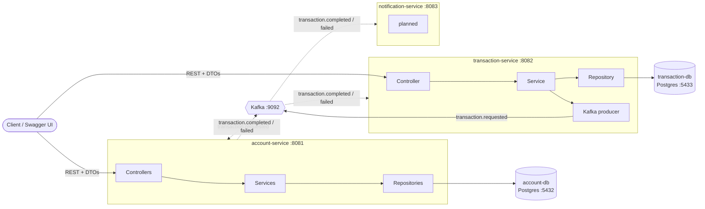

# Bank of Phokaia

Bank of Phokaia is a Java 21 Spring Boot based software.

It runs on a microservice architecture with 4 main services that run on Docker containers.

Services communicate with each other by means of Kafka events.

Outside communication happens through Data Transfer Objects.

---

## Architecture overview



Solid arrows exist today; dotted arrows are the planned event flow.

- **Each service owns its own database.** No service reads another service's tables.
- **REST at the edge, events inside:** clients call services over HTTP with DTOs; services talk to each other only through Kafka events.
- **Shared contract:** event records and topic names live in the `common-events` module, the only code shared between services.

---

## Layer map

Every service follows the same layered structure. Calls only go downward.

| Layer | Responsibility | Talks to |
|---|---|---|
| **Controller** | HTTP in/out, request validation (`@Valid`), status codes | Service (via DTOs) |
| **Service** | Business logic and transaction boundaries (`@Transactional`) | Repositories, entities, Kafka producer |
| **Repository** | Data access (Spring Data JPA) | Database |
| **Entity** | Domain model; protects its own rules | (used by service and repository) |
| **DTO** | Shape of the JSON clients send and receive | (used by controller and service) |
| **Kafka** | Producers/listeners: the event entry and exit doors | Kafka, Service |
| **Exceptions** | `GlobalExceptionHandler` turns exceptions into `ProblemDetail` responses | (cross-cutting) |

### account-service (port 8081, database `accountdb`)

| Layer | Classes |
|---|---|
| Controller | `CustomerController`, `AccountController` |
| Service | `CustomerService`, `AccountService` |
| Repository | `CustomerRepository`, `AccountRepository` (`findByHolderCustomerCode`) |
| Entity | `Customer`, `Account` |
| DTO | `CustomerDTO` (`CreateRequest`, `Response`), `AccountDTO` (`CreateRequest`, `MoneyRequest`, `Response`) |
| Exceptions | `CustomerNotFoundException`, `AccountNotFoundException`, `AccountAlreadyExistsException`, `InsufficientFundsException`, `CurrencyMismatchException`, `GlobalExceptionHandler` |

**Tables**

| Table | Primary key | Columns | Notes |
|---|---|---|---|
| `customers` | `customer_code` (`CUS` + 8 random digits) | `name`, `surname`, `version` | |
| `accounts` | `account_code` (currency + customer code, e.g. `TRYCUS04821937`) | `customer_id` → `customers`, `balance` `numeric(19,2)`, `currency_type`, `version` | one account per currency per customer; `@Version` for optimistic locking |

**Endpoints**

| Method | Path | Result |
|---|---|---|
| POST | `/customers` | 201, new customer |
| GET | `/customers/{customerCode}` | 200 |
| POST | `/accounts` | 201, new account with balance 0 |
| GET | `/accounts/{accountCode}` | 200 |
| POST | `/accounts/{accountCode}/deposit` | 200, updated balance |
| GET | `/accounts?customerCode=...` | 200, all accounts of a customer |

### transaction-service (port 8082, database `transactiondb`)

| Layer | Classes |
|---|---|
| Controller | `TransactionController` |
| Service | `TransactionService` |
| Repository | `TransactionRepository` (`findByFromAccountCodeOrToAccountCodeOrderByCreatedAtDesc`) |
| Entity | `Transaction`, `TransactionStatus` (`PENDING`, `COMPLETED`, `FAILED`) |
| DTO | `TransactionDTO` (`TransferRequest`, `Response`) |
| Kafka | `TransactionEventProducer`, `KafkaTopicConfig` |
| Exceptions | `TransactionNotFoundException`, `GlobalExceptionHandler` |

**Tables**

| Table | Primary key | Columns | Notes |
|---|---|---|---|
| `transactions` | `transaction_id` (UUID) | `from_account_code`, `to_account_code`, `amount` `numeric(19,2)`, `status`, `failure_reason`, `created_at`, `updated_at`, `version` | account codes are plain strings: accounts live in account-service's database |

**Endpoints**

| Method | Path | Result |
|---|---|---|
| POST | `/transactions/transfer` | 202 Accepted, transfer saved as `PENDING` and `TransactionRequested` published |
| GET | `/transactions/{transactionId}` | 200, current status |
| GET | `/transactions?accountCode=...` | 200, transfer history of an account, newest first |

### notification-service (port 8083)

Planned: consumes `transaction.completed` / `transaction.failed` and stores notifications.

### common-events (shared library)

| Event | Topic | Producer → Consumers |
|---|---|---|
| `TransactionRequested` | `transaction.requested` | transaction-service → account-service |
| `TransactionCompleted` | `transaction.completed` | account-service → transaction-service, notification-service |
| `TransactionFailed` | `transaction.failed` | account-service → transaction-service, notification-service |

Topic names are defined once in `KafkaTopics`. The `transactionId` is the Kafka message key, so all events of one transfer stay in order.

---

## Running locally

Requirements: Java 21, Docker Desktop.

```bash
docker compose up -d                                   # Postgres x2, Kafka, Kafka UI
./mvnw -pl common-events -am install                   # once, and after changing common-events
./mvnw -pl account-service spring-boot:run             # http://localhost:8081/swagger-ui.html
./mvnw -pl transaction-service spring-boot:run         # http://localhost:8082/swagger-ui.html
```

Kafka UI: http://localhost:8090
